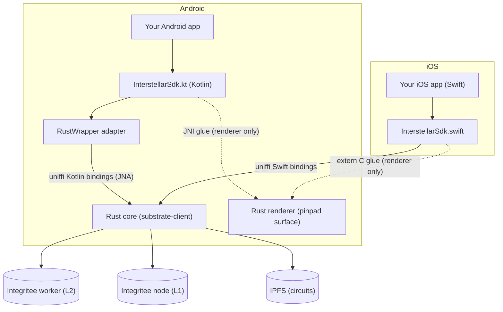

# Interstellar SDK — Overview

The **Interstellar SDK** is the (semi) public component of the Interstellar stack: it allows **third-party wallet providers and dApps** to embed the Interstellar secure-account technology — instant onboarding, policy-gated signing with **visual cryptography (VCA/PoHI)**, and **secure recovery** — directly inside their own Android and iOS applications, without shipping our full wallet UI.

## What the SDK gives you

- **A single `InterstellarSdk` object** per platform (Kotlin on Android, Swift on iOS) that owns all Interstellar state: registration, root account, per-coin accounts, balances, recovery, airdrops, and pinpad/VCA orchestration.
- **Instant onboarding**: the first SDK initialization transparently generates a device key and registers the account on the Interstellar infrastructure. No seed phrase, ever.
- **Coin clients** for `DOT`, `SOL`, `BTC` and `ETH` (addresses, balances, transfers, message signing), all going through the Interstellar worker-mediated, policy-enforced signing pipeline.
- **Trusted Action Validation (VCA / pinpad)**: policy-gated actions are confirmed by the user on a **garbled-circuit-rendered pinpad** (see [Android pinpad](./android/pinpad.md) / [iOS pinpad](./ios/pinpad.md)) — the core anti-injection guarantee of Interstellar.
- **Secure recovery**: VCA-token and NFC recovery methods, threshold configuration, vouch & claim flow.
- **Airdrop campaigns**: create/fund campaigns, user registration & claim (also VCA-protected).
- **MoonPay URL signing** for on/off-ramp integrations.

## Architecture at a glance

The heavy lifting (cryptography, garbled circuits, chain access) is implemented in **Rust**, shared by both platforms. Both platform SDKs speak **the same uniffi FFI surface** to that Rust core (`substrate-client`):

- **Android**: the SDK ships as the Gradle module `:shared` (package `gg.interstellar.wallet`) — the Kotlin SDK (public API + a thin `RustWrapper` adapter over the **committed uniffi-generated Kotlin bindings**, JNA) plus the Rust core compiled as Android `.so` libraries; the device key lives in the **Android Keystore** (P-256 ECDSA). It is published as a **Maven artifact** (`gg.interstellar.wallet:shared`) — see [Getting Started](./android/getting-started.md).
- **iOS**: the SDK ships as a **Swift Package** (`InterstellarSdk`) — the `InterstellarSdk.swift` layer (Keychain-backed P-256 signer) over the **committed uniffi-generated Swift bindings** to the **same Rust core**, plus the pinpad UI and the data model (`CoinType`, …) — see [Getting Started](./ios/getting-started.md).

:::note One per-platform seam: the renderer surface
The only hand-written FFI glue is the pinpad **renderer** surface binding — Android wires it through JNI (`external fun initSurface`, it must hold the Android `Surface` object), iOS through extern `"C"` functions (`init_surface_with_view`, CAMetalLayer). Both wrap the same Rust `renderer` crate; platform surface objects simply cannot cross uniffi.
:::

Because the two platform APIs are *independent codebases* (Kotlin vs Swift), they are **documented separately** — but their **function names are identical** (`getterRootAccount()`, `updateBalances()`, `prepareCoinTransfer()`, …), so an app can be ported from one platform to the other without renaming anything. Only the **signatures** differ (e.g. `StateFlow<T>` vs `@Published`, `BigDecimal` vs `Decimal`, amounts in display units on Android and in atomic units on iOS) — each reference spells its own contract out, and the [iOS reference](./ios/api-reference.md#differences-from-android-quick-map) ends with an explicit differences table.

- 👉 [**Android SDK**](./android/index.md)
- 👉 [**iOS SDK**](./ios/index.md)

## Key concepts

| Concept | Description |
| --- | --- |
| **Root account** | The Interstellar *smart account* of this device, returned as 32 bytes (`getterRootAccount()` on both platforms). Created automatically at first init. |
| **Coin client account** | One keypair per supported coin (DOT/SOL/BTC/ETH) derived from the root account. Its address can be funded from a faucet and used as a transfer recipient. |
| **VCA / pinpad** | A full-screen, circuit-rendered pad where the user re-enters a code to authorize an action. Driven by SDK state (`navigateToPinpad`, `pendingCircuitsPackage`) — you only render the view the SDK hands you. |
| **Server reset** | If the Interstellar server loses the account (e.g. devnet reset), the SDK detects it at init/resume and asks your app to confirm **re-registration** before proceeding. |
| **Recovery** | VCA token files and/or NFC cards registered as recovery methods; a lost device vouches, waits ~10 blocks, then claims. |

## Status & scope (please read)

:::warning Not public (yet) — private distribution
The SDK is **not public**: it lives in the private **`wallet-app-internal`** repository and is distributed to **reviewers and testers only**, through that repository's access control. There is no open-source release.

The **publishing pipelines are implemented and continuously verified by the CI** (see [below](#the-artifacts-are-proved-by-the-ci)), and the artifacts **are published** — the **M6 release is cut**: `m6-v1`. The versions below are the **current** ones; new versions follow each SDK release.

| Platform | Distribution mechanism | Coordinate |
| --- | --- | --- |
| **Android** | **GitHub Packages** (a Maven registry) — repository-scoped, so the package inherits the repo's visibility and stays **private** | `gg.interstellar.wallet:shared:<version>` from `https://maven.pkg.github.com/interstellar-network/wallet-app-internal` |
| **iOS** | **GitHub Releases** — SPM has no Maven; a release asset *is* the registry. One zip contains the complete Swift package | `InterstellarSdk-<version>.zip` from the [`m6-v1` release](https://github.com/Interstellar-Network/wallet-app-internal/releases/tag/m6-v1) |

At the time of writing the current version is **`0.1.0`** (Android: the `shared` package; iOS: the `InterstellarSdk-0.1.0.zip` asset of `m6-v1`). New versions follow each SDK release — check the [releases page](https://github.com/Interstellar-Network/wallet-app-internal/releases) for the latest.
:::

### How a tester gets access

1. **Repository access** — ask Interstellar for read access to the private [`wallet-app-internal`](https://github.com/Interstellar-Network/wallet-app-internal) repository. **The access is needed for the registry, not for the sources.** The SDK artifacts could be published/hosted anywhere; for simplicity we chose GitHub's **built-in** registry mechanisms (GitHub Packages for Android, GitHub Releases for iOS) on the same repository as the SDK sources. Those GitHub registries are **scoped to the repository they live on**, so the artifacts are only visible to accounts that can read `wallet-app-internal` — reading the sources with the same access is a side effect.
2. **Android — GitHub Packages (Maven)**:
   - create a **classic** personal access token with the **`read:packages`** scope (GitHub Packages does **not** support fine-grained tokens) and, if the organisation enforces SAML SSO, authorize it for `Interstellar-Network`;
   - put the credentials in your **global** `~/.gradle/gradle.properties` (`gpr.user` = your GitHub username, `gpr.key` = the token) — never in the project (the file does not exist by default: create it with `touch ~/.gradle/gradle.properties`);
   - add the repository to `settings.gradle.kts` (the **owner must be lowercase**).
   - Full walkthrough: [Android — Getting Started](./android/getting-started.md#step-2--get-access-to-the-sdk).
3. **iOS — the private GitHub release**:
   - download the release asset with your GitHub account (browser) or with the CLI — `gh release download m6-v1 -R Interstellar-Network/wallet-app-internal -p "InterstellarSdk-*.zip"` (the CLI needs a token with the `repo` scope);
   - unzip it and add the `InterstellarSdk` folder as a **local** Swift package — Xcode links *and embeds* the frameworks by itself;
   - the two `.xcframework`s are also attached **individually** (with their SPM checksums), but the **remote `.binaryTarget(url:checksum:)` flow is not recommended for a private repo**: SwiftPM downloads binary targets anonymously (nowhere to put a token) and every new build invalidates the checksum — see [why](./ios/getting-started.md#why-not-a-remote-hosted-swift-package).
   - Full walkthrough: [iOS — Getting Started](./ios/getting-started.md#step-2--download-the-sdk).
4. **Endpoints & test keys** — the shared testnet endpoints (and the MoonPay/Reown test keys, see the [M6 demo notes](/developers/Milestones/M6/local-demo-with-docker)) are provided by Interstellar on request.

### The artifacts are proved by the CI

Both platforms are validated end-to-end by a **consumer smoke test** that runs on every CI build — a *real external consumer app* is built against the published artifact, exactly like you would:

| Platform | What the CI does | Where |
| --- | --- | --- |
| **Android** | publishes `:shared` to a **local Maven repo** and builds the standalone `sdk-consumer/` project (debug **and** release) against `gg.interstellar.wallet:shared:<version>`, then asserts both APKs contain the `arm64-v8a` **and** `x86_64` native libraries | `wallet-app-internal` → `sdk-consumer/` |
| **iOS** | runs the real publish script (`--no-publish`), **unzips the published zip** into `sdk-consumer-ios/SDK/`, builds the consumer app against it, checks the two frameworks are **embedded** in the app bundle, then **runs it in the simulator** and asserts its output | `wallet-app-internal` → `sdk-consumer-ios/` |

This is what guarantees that a consumer needs **no Rust, no NDK, no uniffi, no Kotlin/Native and no linker flags** — and it is why the guides above need nothing but Android Studio / Xcode.

:::note Building from source is still possible
If you have the repository, you can always build the SDK from source and consume it locally (Android: the `:shared` Gradle module; iOS: the reference app's Gradle/Xcode bridge). See the "Alternative" sections of the two getting-started guides.
:::

Until the final testnet release:

- Public API surface may change between milestone deliveries.
- The default backend URLs point at the **local dev stack** (`wss://127.0.0.1:2090`, `ws://127.0.0.1:9944`, `/ip4/127.0.0.1/tcp/5001`) — production/testnet endpoints are provided by Interstellar.
- USD prices used by the balance helpers are **hardcoded constants** meant for demo/dev flows.

The full wallet application (`wallet-app`) is the reference integration of this SDK — every feature described here is exercised by that app on both platforms.
