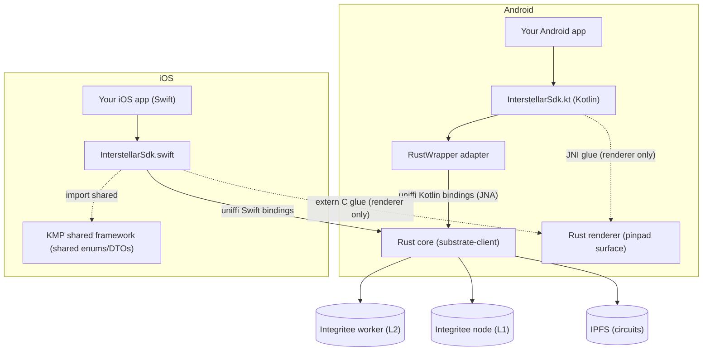

# Interstellar SDK — Overview

The **Interstellar SDK** is the (semi) public component of the Interstellar stack: it allows **third-party wallet providers and dApps** to embed the Interstellar secure-account technology — instant onboarding, policy-gated signing with **visual cryptography (VCA/PoHI)**, and **secure recovery** — directly inside their own Android and iOS applications, without shipping our full wallet UI.

## What the SDK gives you

- **A single `InterstellarSdk` object** per platform (Kotlin on Android, Swift on iOS) that owns all Interstellar state: registration, root account, per-coin accounts, balances, recovery, airdrops, and pinpad/VCA orchestration.
- **Instant onboarding**: the first SDK initialization transparently generates a device key and registers the account on the Interstellar infrastructure. No seed phrase, ever.
- **Coin clients** for `DOT`, `SOL`, `BTC` and `ETH` (addresses, balances, transfers, message signing), all going through the Interstellar worker-mediated, policy-enforced signing pipeline.
- **Trusted Action Validation (VCA / pinpad)**: policy-gated actions are confirmed by the user on a **garbled-circuit-rendered pinpad** (see [Android pinpad](./android/pinpad.md) / [iOS pinpad](./ios/pinpad.md)) — the core anti-injection guarantee of Interstellar.
- **Secure recovery**: VCA-token and NFC recovery methods, threshold configuration, vouch & claim flow.
- **Airdrop campaigns**: create/fund campaigns, user registration & claim (also VCA-protected).
- **MoonPay URL signing** for on/off-ramp integrations.

## Architecture at a glance

The heavy lifting (cryptography, garbled circuits, chain access) is implemented in **Rust**, shared by both platforms. Both platform SDKs speak **the same uniffi FFI surface** to that Rust core (`substrate-client`):



- **Android**: the SDK ships as the Gradle module `:shared` (package `gg.interstellar.wallet`) — the Kotlin SDK (public API + a thin `RustWrapper` adapter over the **committed uniffi-generated Kotlin bindings**, JNA) plus the Rust core compiled as Android `.so` libraries; the device key lives in the **Android Keystore** (P-256 ECDSA).
- **iOS**: the SDK is the `InterstellarSdk.swift` layer (Keychain-backed P-256 signer) over the **committed uniffi-generated Swift bindings** to the **same Rust core**, plus the Kotlin Multiplatform `shared` framework for the shared enums/DTOs (`CoinType`, …).

:::note One per-platform seam: the renderer surface
The only hand-written FFI glue is the pinpad **renderer** surface binding — Android wires it through JNI (`external fun initSurface`, it must hold the Android `Surface` object), iOS through extern `"C"` functions (`init_surface_with_view`, CAMetalLayer). Both wrap the same Rust `renderer` crate; platform surface objects simply cannot cross uniffi.
:::

Because the two platform APIs are *independent codebases* (Kotlin vs Swift), they are **documented separately** — the signatures are intentionally close but not identical (e.g. `getterRootAccount()` on Android vs `getRootAccount()` on iOS). Where a behavior is exactly shared (pinpad orchestration, server-reset semantics, VCA flows) both references say the same thing.

- 👉 [**Android SDK**](./android/index.md)
- 👉 [**iOS SDK**](./ios/index.md)

## Key concepts

| Concept | Description |
| --- | --- |
| **Root account** | The Interstellar *smart account* of this device, returned as 32 bytes (`getterRootAccount()` / `getRootAccount()`). Created automatically at first init. |
| **Coin client account** | One keypair per supported coin (DOT/SOL/BTC/ETH) derived from the root account. Its address can be funded from a faucet and used as a transfer recipient. |
| **VCA / pinpad** | A full-screen, circuit-rendered pad where the user re-enters a code to authorize an action. Driven by SDK state (`navigateToPinpad`, `pendingCircuitsPackage`) — you only render the view the SDK hands you. |
| **Server reset** | If the Interstellar server loses the account (e.g. devnet reset), the SDK detects it at init/resume and asks your app to confirm **re-registration** before proceeding. |
| **Recovery** | VCA token files and/or NFC cards registered as recovery methods; a lost device vouches, waits ~10 blocks, then claims. |

## Status & scope (please read)

:::warning Not public (yet) — access is granted via the private repo
The SDK is **not public at this time**: no open-source release and no package-registry artifact yet. What you get instead:

- **Repository access** — reviewers and integrators are granted (or already have) read access to the private **`wallet-app-internal`** repository, the SDK's source of truth. A plain clone is all the [Android](./android/getting-started.md) / [iOS](./ios/getting-started.md) getting-started guides need:

  ```bash
  git clone ssh://git@github.com/Interstellar-Network/wallet-app-internal.git
  ```

- **Endpoints & test keys** — the shared testnet endpoints (and MoonPay/Reown test keys, see the [M6 demo notes](/developers/Milestones/M6/local-demo-with-docker)) are provided by Interstellar on request.

- **Artifact publication — TBD (placeholder)**: publishing the SDK as a proper dependency (e.g. a Maven coordinate for Android / an SPM package for iOS) is planned but **does not exist yet** — until it does, the git repository above is the only distribution channel. Ask us for the current status.

Until the final testnet release:

- Public API surface may change between milestone deliveries.
- The default backend URLs point at the **local dev stack** (`wss://127.0.0.1:2090`, `ws://127.0.0.1:9944`, `/ip4/127.0.0.1/tcp/5001`) — production/testnet endpoints are provided by Interstellar.
- USD prices used by the balance helpers are **hardcoded constants** meant for demo/dev flows.
:::

The full wallet application (`wallet-app`) is the reference integration of this SDK — every feature described here is exercised by that app on both platforms.
